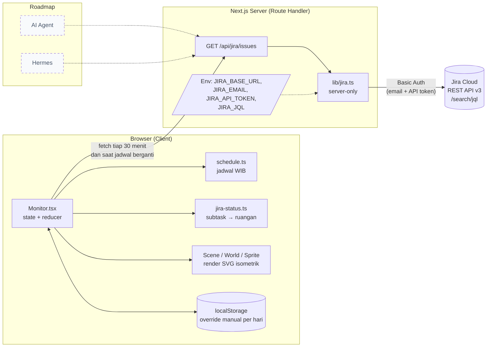
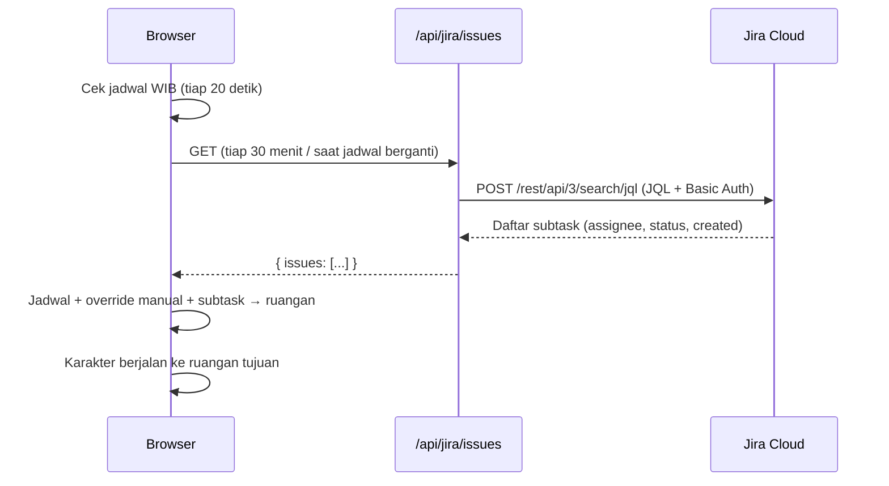

# Balkar Monitoring Team

Dashboard monitoring tim harian yang tampil sebagai **kantor isometrik**. Setiap anggota tim adalah karakter yang berpindah ruangan secara otomatis sesuai subtask Jira hari ini, jadwal kerja (WIB), dan status manual (sakit, cuti, dll).

> Status: **v1 berjalan**: terintegrasi dengan Jira Cloud. Integrasi **AI Agent** dan **Hermes** masuk roadmap (belum diimplementasi).

## Fitur

- **Sinkron Jira**: subtask hari ini ditarik dari Jira Cloud (lewat filter/JQL) tiap 30 menit, dan langsung dipetakan ke ruangan.
- **Jadwal otomatis (WIB)**: makan & sholat, meeting sore, pulang, dan libur akhir pekan mengubah posisi karakter tanpa input manual.
- **Tujuh ruangan**: Kerja, Review, SPV, Cuti, Sakit, War Room, Istirahat.
- **Notifikasi**: anggota tanpa subtask hari ini berdiri di pinggir Ruang Kerja dengan peringatan "Belum memiliki subtask hari ini".
- **Override manual per hari**: pilihan dropdown (sakit, cuti, dll) tersimpan di localStorage browser dan hangus otomatis saat ganti hari.
- **Mode kantor tutup**: saat jam pulang, scene gelap dan semua karakter menghilang.

## Aturan penempatan karakter

Dievaluasi dari atas ke bawah; aturan pertama yang cocok menang.

| Prioritas | Kondisi (WIB) | Ruangan |
|---|---|---|
| 1 | Pulang: Senin–Kamis 16:30, Jumat 16:45 (dan sebelum 08:00) | Kosong dan gelap |
| 2 | Sabtu–Minggu | Ruang Cuti |
| 3 | Pilihan manual dari dropdown | Sesuai pilihan |
| 4 | Meeting cek poin sore, mulai 16:00 | War Room |
| 5 | Makan & sholat: Senin–Kamis 12:00–13:00, Jumat 12:00–13:30 | Ruang Istirahat |
| 6 | Subtask Jira aktif | Ruang Kerja (atau Review bila statusnya review/verifikasi/konfirmasi) |
| 7 | Tidak ada subtask aktif hari ini | Pinggir Ruang Kerja + notifikasi |

Subtask yang dihitung "hari ini": semua yang masih aktif, ditambah yang **dibuat hari ini**. Subtask DONE yang dibuat sebelum hari ini tidak dihitung.

## Arsitektur



**Kenapa ada sisi server?** Token Jira tidak boleh sampai ke browser, dan Jira Cloud memblokir panggilan langsung dari browser (CORS). Karena itu browser hanya memanggil `/api/jira/issues`; token hanya dibaca di server. Tidak perlu backend terpisah: Route Handler Next.js berjalan sebagai fungsi serverless.

### Alur data



## Tech stack

- [Next.js](https://nextjs.org) 16 (App Router, Cache Components) · React 19 · TypeScript
- Tailwind CSS 4
- Render scene: SVG isometrik buatan sendiri (tanpa library grafis)
- Tanpa database: state hidup di browser, sumber data utama adalah Jira

## Struktur folder

```
app/
  page.tsx                    # memuat <Monitor />
  api/jira/issues/route.ts    # endpoint server → Jira
components/
  Monitor.tsx                 # state, polling, jadwal, panel UI
  Scene.tsx                   # kanvas SVG, zoom/geser, gelembung chat
  World.tsx                   # lantai, dinding, furnitur tiap ruangan
  Sprite.tsx                  # karakter
lib/
  data.ts                     # ruangan, status, daftar karyawan (+ accountId Jira)
  layout.ts                   # slot kursi, jalur jalan
  jira.ts                     # klien Jira (server-only)
  jira-status.ts              # aturan subtask → ruangan
  schedule.ts                 # jadwal WIB & prioritas penempatan
  iso.ts                      # proyeksi isometrik
```

## Menjalankan lokal

```bash
npm install
cp .env.example .env.local   # lalu isi nilainya (lihat tabel di bawah)
npm run dev                  # http://localhost:3000
```

### Environment variable

Semua variabel hanya dibaca di server. **Jangan** beri awalan `NEXT_PUBLIC_` karena itu membuka nilainya ke browser.

| Variabel | Keterangan | Contoh |
|---|---|---|
| `JIRA_BASE_URL` | URL site Jira Cloud | `https://namasite.atlassian.net` |
| `JIRA_EMAIL` | Email akun Atlassian pemilik token | `nama@perusahaan.co.id` |
| `JIRA_API_TOKEN` | API token dari https://id.atlassian.com/manage-profile/security/api-tokens | |
| `JIRA_JQL` | JQL untuk menarik subtask | `filter = 12345 AND (statusCategory != Done OR created >= startOfDay()) ORDER BY updated DESC` |

`.env*` sudah di-ignore git. Jangan pernah meng-commit token.

## Deploy

Aplikasi ini butuh sisi server (Route Handler), jadi tidak bisa di-export static. Cara termudah: **Vercel**.

1. Import repo ke Vercel.
2. Di *Environment Variables*, tempel isi `.env.local` (Vercel mem-parse otomatis).
3. Deploy.

Catatan: endpoint `/api/jira/issues` menampilkan judul tiket Jira. Lindungi akses (login, VPN, atau IP kantor) bila isi tiket sensitif.

## Menambah karyawan

Tambahkan entri di `INITIAL` pada [lib/data.ts](lib/data.ts) dengan `jiraId` (accountId Jira) agar cocok dengan assignee, lalu pastikan JQL/filter Jira mencakup orang tersebut.

## Roadmap

- [ ] **AI Agent**: ringkasan harian tim, deteksi tugas macet, dan rekomendasi.
- [ ] **Hermes**: integrasi (detail menyusul).
- [ ] Penyimpanan override manual di server agar sama di semua perangkat.
- [ ] Hari libur nasional.
- [ ] Proteksi akses (login atau kunci rahasia).
